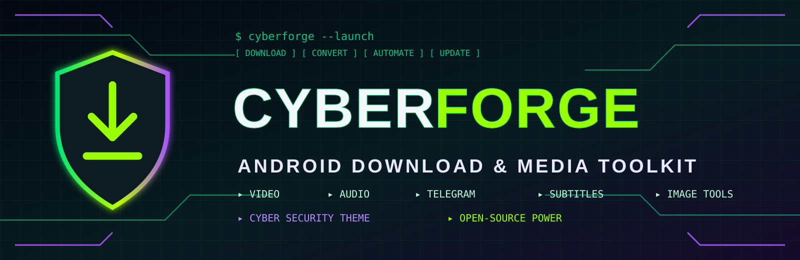

<p align="center">
  
</p>

<h1 align="center">CyberForge</h1>
<p align="center"><strong>Android Download & Media Toolkit for Termux</strong></p>

<p align="center">
  
  
  
  
  
  
</p>

CyberForge is a menu-driven downloader and media toolkit built for **Termux on Android**. It brings video, audio, subtitles, Telegram media, playlists, documents, APK downloads, image processing, and tool updates into one terminal interface.

> The cyber-security-inspired artwork is a visual theme. CyberForge is a downloader and media toolkit, not a security scanner or penetration-testing tool.

## Features

- **Video downloads:** Best, 2160p, 1440p, 1080p, 720p, 480p, or 360p.
- **Turbo downloads:** up to eight yt-dlp fragments where the source supports parallel fragments.
- **Video + subtitles:** download the video and available English subtitles together, with subtitle embedding when supported.
- **Video-only downloads:** save a video stream without an audio track.
- **Video trimming:** download a selected time range.
- **Audio:** extract audio and save it as MP3.
- **Playlists:** save playlist items into a named folder with numbered filenames.
- **Telegram:** download public Telegram media with selectable 1, 2, 4, or 8 transfer threads using the standard `tdl` release.
- **Document Manager:** search local filenames and file types, select multiple results, read/open, delete, copy, move, or convert supported documents and images directly from selected-results actions, inspect file details, and download documents or archives. Storage roots are checked for real read/write access.
- **Sequential queue:** process links one by one and keep failed or cancelled links for retry.
- **APK downloads:** direct APK URLs and optional APKPure/F-Droid sources through `apkeep`.
- **Image and media tools:** direct image and supported gallery downloads, video thumbnails, crops, resizing, conversion, compression, metadata stripping, Expo/Web asset packs, and image-to-PDF.
- **Movie and series search:** find legitimate availability through Google, JustWatch, or IMDb.
- **Android network shortcut:** open Android Radio Information for manual LTE/4G selection.
- **Tool update center:** update Termux packages, yt-dlp, optional Python media tools, and inspect installed versions without leaving the menu.
- **Android sharing:** share supported links from other apps to Termux.
- **Input validation:** invalid menu choices and validated fields can be retried up to three times with a clear error; yes/no confirmations retain their normal confirmation behavior.

## Requirements

Use the **Termux app from F-Droid or the official Termux GitHub releases**. Avoid mixing Termux with the outdated Play Store build.

### 1. Install required packages

Open Termux and run:

```bash
pkg update && pkg upgrade -y
pkg install git python ffmpeg curl tdl -y
python -m pip install -U yt-dlp
termux-setup-storage
```

When Android asks for storage access, allow it. This lets CyberForge save downloads in shared Movies, Music, Pictures, and Documents folders.

### 2. Optional packages

Install these only when you need their features:

```bash
# Social/gallery image downloads
python -m pip install -U gallery-dl

# Image-to-PDF support
python -m pip install -U pillow

# Document conversion (optional)
pkg install pandoc
# Selectable-text PDF extraction (optional, no OCR)
pkg install poppler

# Image format conversion in Document Manager
pkg install imagemagick

# Android notifications and media scanning
pkg install termux-api -y

# Editing the download queue
pkg install nano -y
```

The APKPure and F-Droid menu options need `apkeep`, installed separately. Direct APK URL downloads do not require it.

## Installation

Clone the latest version from the `main` branch:

```bash
git clone -b main https://github.com/Codeforge-mame/termux-cyber-downloader.git ~/termux-cyber-downloader
cd ~/termux-cyber-downloader
bash install.sh
source ~/.bashrc
```

The installer keeps the complete project in `~/termux-cyber-downloader` and installs launchers in `~/bin`. It also adds the launch commands to your shell path.

If you already cloned the repository, run the last three commands from its folder.

## How to use

### Open CyberForge

```bash
DL
```

Other launch options:

```bash
cyberforge
bash ~/bin/termux-url-opener
```

### Open help

```bash
cyber-help
```

### Share a link from Android

1. Open the app containing the link.
2. Tap **Share**.
3. Choose **Termux**.
4. CyberForge automatically routes public Telegram links and supported document links. Other links open the main menu with the shared URL.

## Main menu

| Option | Tool |
|---:|---|
| 1 | Video download |
| 2 | Turbo video |
| 3 | Trim video clip |
| 4 | Audio MP3 |
| 5 | Telegram download |
| 6 | Sequential queue |
| 7 | APK downloader |
| 8 | Movie / series search |
| 9 | Playlist download |
| 10 | Image & media tools |
| 11 | Video extras: video + subtitles / video-only |
| 12 | Document Manager: local file search and document / file download |
| 13 | Android 4G network settings |
| 14 | Tool update center |

## Document Manager

Choose **12) Document Manager** from the main menu. Search by filename or file type, select one or more results, and choose an available action. Conversion is integrated into the selected-file actions, not a separate menu.

- **Find local files:** search by filename or keyword in internal shared storage and detected accessible removable volumes.
- **Search by file type:** find PDFs, Word/text documents, spreadsheets, presentations, images, archives, audio, video, or APK packages. You can also enter a custom extension.
- **Multi-select:** enter indexes such as `1 35 74 83`, comma-separated indexes, or ranges such as `1-5`. The manager displays up to 100 results per search.
- **Delete:** delete one or multiple selected files only after typing `DELETE` at the confirmation prompt.
- **Copy / move:** choose an accessible destination location and optional subfolder. Existing-name collisions can be skipped, automatically renamed to keep both files, or replaced after a separate confirmation.
- **Move safety:** CyberForge copies and byte-verifies each file before removing its original. If verification fails, the source is retained.
- **Read / open:** preview the first 200 lines of text files in the terminal, extract selectable PDF text with Poppler, convert supported office documents to plain text with Pandoc, or open media and other binary files with Android through Termux:API.
- **Convert selected files:** convert supported DOCX, ODT, EPUB, HTML, Markdown, TXT, RTF, selectable-text PDF, and common raster images (JPG, PNG, WebP, BMP, GIF, TIFF). Image files can also be converted to PDF. Document-to-PDF requires Pandoc plus a supported PDF engine such as Tectonic, XeLaTeX, LuaLaTeX, or WeasyPrint. PDF input extraction requires Poppler; image conversion requires ImageMagick. Scanned PDFs are not supported because OCR is not included.
- **Download a file:** the URL downloader remains available inside this menu.

Storage discovery probes actual directory listing and write access. Locations are labelled `read/write` or `read only`; only writable locations are offered as copy/move destinations. Run `termux-setup-storage` and grant Termux file access if a mounted volume is missing. Android scoped-storage restrictions can still prevent access to some SD/USB folders, even when Android shows them in its file manager.

After each successful conversion, choose to keep the file in `Documents/Converted` or move it to a detected writable SD card / USB drive under `CyberForge/Converted`. Removable storage is offered only when Termux can read and write it. The source file is never modified, and existing converted files are never silently overwritten. Image conversion omits the source format from its target choices. Document-to-PDF needs Pandoc and a supported PDF engine; image-to-PDF uses ImageMagick. OCR and document-content search are not included.

## Video + subtitle downloads

Choose **11 → 1** in the main menu, paste a supported video URL, then choose a resolution. CyberForge requests the video stream and available English subtitle tracks in the same operation. It attempts to convert and embed subtitles into the video using FFmpeg.

Some sources do not provide English subtitles, and some subtitle formats cannot be embedded into every container. In those cases, the video may download without an embedded English track or the source may report that subtitles are unavailable.

Files are saved under `Movies/Subtitles`.

## Updating tools inside CyberForge

Choose **14) Tool update center** from the main menu.

- **Update all Termux packages:** updates installed Termux packages, including FFmpeg and tdl.
- **Update yt-dlp:** upgrades yt-dlp with Python pip.
- **Update optional Python media tools:** upgrades gallery-dl and Pillow only if installed.
- **Update all installed CyberForge tools:** updates Termux packages and installed Python media tools.
- **Show installed tool versions:** displays versions for the available command-line tools.
- **Check which tools need updates:** refreshes Termux package indexes and lists upgradable Termux and Python packages.

Updates require an internet connection. Review package-manager output if an update fails. The optional `apkeep` tool is not managed by the Python updater.

## Where downloads are saved

- Videos and Telegram: `~/storage/movies`
- Telegram subfolder: `~/storage/movies/Telegram`
- Video + subtitles: `~/storage/movies/Subtitles`
- Music: `~/storage/music`
- Images: `~/storage/pictures`
- Documents: `~/storage/shared/Documents`
- APKs: `~/storage/shared/Documents/APKs`

## Update CyberForge itself

The in-app update center updates installed tools, not the CyberForge source code. To update the project:

```bash
cd ~/termux-cyber-downloader
git switch main
git pull --ff-only origin main
bash install.sh
source ~/.bashrc
```

Your download history and queue are stored in `data/`. Back up local changes to those files before switching branches or resolving Git conflicts.

## Behavior and limitations

- **Telegram resume:** CyberForge uses the standard `tdl` release. It passes `--continue --skip-same`, but an interrupted temporary file may be removed by tdl; retrying may restart that file. Byte-level Telegram resume is not included.
- **Document resume:** continuing a partial download depends on the remote server supporting HTTP Range requests.
- **Download speed:** turbo mode and extra Telegram threads do not guarantee faster downloads. Actual speed depends on the source, network, and server limits.
- **Image downloads:** social/gallery support depends on the installed gallery-dl version and the website.
- **Network shortcut:** LTE-only mode may affect voice calls. Restore Auto or LTE/WCDMA if needed.
- **APK safety:** verify the publisher and APK signature before installing, especially for third-party sources.
- **Copyright and authorization:** only download content you own, have permission to access, or are otherwise legally allowed to download.

## Project structure

```text
termux-cyber-downloader/
├── assets/
│   └── cyberforge-banner.svg
├── install.sh
├── termux-url-opener
├── help_script
├── lib/
│   ├── colors.sh
│   ├── config.sh
│   └── common.sh
├── modules/
│   ├── main_menu.sh
│   ├── video.sh
│   ├── documents.sh
│   ├── image.sh
│   ├── telegram.sh
│   ├── queue.sh
│   ├── apk.sh
│   ├── movie.sh
│   └── tools.sh
├── legacy/       # inactive backup
└── data/         # download queue and history
```

## Contributing

Bug reports and practical improvements are welcome. When reporting a problem, include your Termux version, Android version, menu option, and relevant error output. Remove private URLs and personal information from logs before sharing.

---

**CyberForge** is maintained by [Codeforge-mame](https://github.com/Codeforge-mame).
